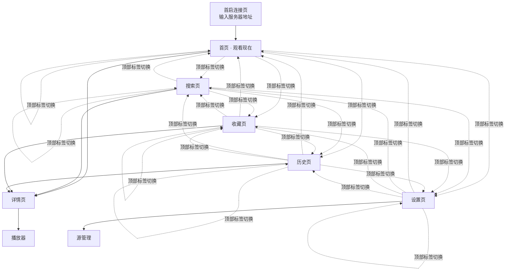
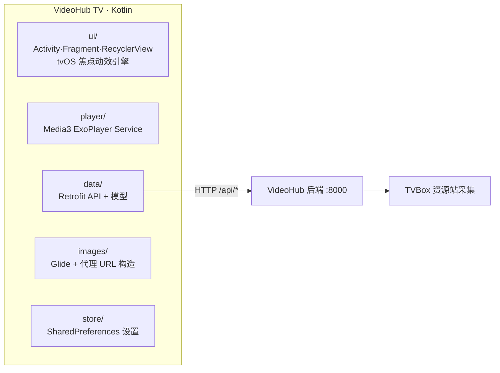

# VideoHub TV 设计文档

版本 v0.1（2026-10-24） · 目标设备：长虹电视（Android 9 / API 28，1080p，红外遥控器）
UI 风格：Apple TV（tvOS） · 后端：完全复用现有 VideoHub FastAPI 服务，**零改动**

---

## 1. 概述与结论

把手机端 VideoHub APP 的能力搬到电视上，做成一个**原生 Android 电视应用**，用遥控器操作，界面采用 Apple TV 的设计语言：纯黑背景、顶部大字标签导航、横向卡片货架（shelf）、焦点放大 + 白色描边 + 投影的焦点动效。

技术结论（详见第 7 节）：

| 决策点 | 结论 | 理由 |
|---|---|---|
| 应用形态 | 原生 Android（Kotlin），非 WebView 壳 | 电视 WebView 性能差、HLS 播放不稳；原生播放器在弱 SoC 上最可靠 |
| UI 框架 | View 体系（RecyclerView）+ 自研 tvOS 风格焦点引擎 | Leanback 是 Android TV 风格且偏旧；Compose 对 1GB 内存电视有风险 |
| 播放器 | Media3 ExoPlayer | HLS 成熟，原生支持倍速/seek/自动连播 |
| 网络 | Retrofit + OkHttp + kotlinx.serialization | 直接对接现有 REST API |
| 图片 | Glide（override 降采样 + 内存缓存） | 封面全部走后端 `/api/proxy/image` 防盗链代理 |
| 分发 | APK 侧载，放到后端 `apk/` 目录（已有 StaticFiles 挂载） | 与手机 APP 一致的升级方式 |

---

## 2. 功能范围（与手机 APP 对齐）

### 2.1 保留的功能

| 手机 APP 功能 | TV 端落地 | 使用的后端 API |
|---|---|---|
| 首次连接引导（输入服务器地址） | 首启连接页，校验后保存 | `GET /api/health` |
| 站点/分类浏览首页 | 首页货架 + 分类行 + 站点切换 | `GET /api/sources/{id}/sites`、`GET /api/site/categories` |
| 聚合搜索（按源分组） | 搜索页：输入法输入 + 热词/历史词 | `GET /api/search/all` |
| 影片详情 + 选集 + 多播放组 | 详情页：左侧信息、右侧集数宫格 | `GET /api/site/detail` |
| 播放（m3u8 代理、倍速、自动连播） | 播放页 + 遥控器 OSD | `GET /api/proxy/m3u8`、`/api/proxy/stream` |
| 断点续播（看到哪集哪秒） | 首页「继续观看」行 + 详情页续播按钮 | `GET/POST /api/history` |
| 收藏 + 追更红点（更新 N 集） | 收藏页 + 首页收藏行 badge | `GET/POST /api/favorites`、`/clear-update` |
| 源管理（增删、健康检测） | 设置页 → 源管理（遥控器输入 URL） | `/api/sources` 系列 |
| 播放设置（默认倍速/连播/记历史） | 设置页开关列表 | `GET/PUT /api/settings` |
| 备份恢复 | 设置页（以导出/导入为主，导入走 U 盘文件选择） | `GET /api/backup`、`POST /api/restore` |

### 2.2 TV 端裁剪

- **画中画**：电视无意义，去掉。
- **外部播放器**：保留为播放失败时的兜底（系统 Intent，可选）。
- **手势操作**：无，全部遥控器化。
- **主题色切换**：tvOS 风格即深色，不提供多主题。

### 2.3 TV 端新增

- **长按 OK 快捷菜单**：卡片上长按 → 玻璃菜单（从第 1 集播放 / 换源 / 收藏 / 从历史删除）。
- **首页「继续观看」置顶行**：tvOS Up Next 式样，带进度条，一键续播。
- **双击返回退出**：Android 电视惯例（Toast 提示「再按一次退出」）。
- **服务器状态指示**：右上角小圆点，绿=在线 / 红=断线（复用 health 轮询）。

---

## 3. tvOS 设计语言规范

以 **1920×1080** 为设计基准（px 值均指 1080p 下的物理像素；实现时用 dp + 百分比布局）。

### 3.1 安全区与栅格

- 屏幕四周安全边距：**60px**（约 3%，兼顾老面板 overscan）。
- 顶部标签栏高度 120px，主内容区从 y=140 开始。
- 卡片行横向排布，行内间距 24px，行与行之间（含行标题）整体高度 300px。

### 3.2 颜色

| 用途 | 色值 |
|---|---|
| 背景 | `#000000`（纯黑，tvOS 标志） |
| 主文字 | `#FFFFFF` |
| 次级文字 | `#8E8E93`（SF Gray） |
| 焦点描边 | `#FFFFFF` 4px |
| 强调/选中 | `#0A84FF`（tvOS Blue） |
| 追更/错误 | `#FF453A` |
| 成功/在线 | `#30D158` |
| 玻璃面板 | `rgba(30,30,34,0.78)` + 40px 大圆角 + 背景模糊 |

### 3.3 字体

- 系统默认中文字体（Noto Sans SC / 厂商字体），标题 700 字重，正文 400。
- 顶部标签：未聚焦 36px / `#7C7C86`；聚焦 44px / 白色 / 放大 1.15。
- 页面大标题 64px；行标题 36px；卡片标题 26px；说明文字 24px。
- 最小可读字号 22px（电视观看距离 2.5m+，不能再小）。

### 3.4 卡片与焦点动效

- 标准内容卡：**16:9 横版**（TVBox 源封面基本是横版），常规 336×189，圆角 16px。
- 焦点态：`scale(1.10)` + 白色 4px 描边 + `0 24px 60px rgba(0,0,0,0.7)` 投影。
- 动效曲线：`180ms cubic-bezier(0.2, 0.8, 0.2, 1)`；焦点切换只做缩放与描边，**不做实时高斯模糊**（弱 SoC 拿不动，用深色渐变遮罩代替毛玻璃背景）。
- Hero 大图：首页顶部 933×525，聚焦时显示片名 + 简介 + 播放按钮，背景延伸渐变到纯黑。
- badge：追更红点胶囊「更新 N 集」，右上角；进度条：卡片底部 3px 白色。

### 3.5 页面滚动

内容行数超屏时整页垂直滚动（标签栏固定悬浮，内容从其下方滚过），滚动随焦点移动平滑带动，绝不出滚动条。

---

## 4. 信息架构

顶部标签栏（tvOS 式）：**首页 · 搜索 · 收藏 · 历史 · 设置**，固定 5 个，聚焦放大白色。**焦点即切页**——焦点落到标签时页面立即切换（左右扫标签实时换页，无需按 OK）；按 OK 把焦点送入当前页内容（等价于按 ↓）。各页面不得在焦点停留于标签栏时抢焦点（冷启动例外：用户未按过键时首页会把焦点抢到 Hero，按 OK 直接续看）。

---

## 5. 页面详细设计

### 5.1 连接页（首启 / 失联时）

- 居中卡片：Logo + 「连接到 VideoHub 服务器」。
- 地址输入：预设候选（上次地址、`http://192.168.101.18:8000` 默认值），遥控器调起系统输入法；另配**网格键盘兜底**（部分长虹精简系统无输入法）。
- 连接中显示 spinner；失败显示原因（超时/非 VideoHub 服务）+ 重试。
- 连接成功后地址写入 SharedPreferences，之后启动直接进首页（后台静默 health 检查，失联时顶部红点 + 提示条）。

### 5.2 首页（观看现在）

自上而下：

1. **Hero 区**：今日推荐/最近在追的大图（取「继续观看」第 1 条或收藏最新更新），聚焦显示信息与播放按钮。
2. **继续观看**：历史记录横排卡（底部进度条 + 「看到第 N 集」），OK 直接从断点续播。
3. **我的收藏 · 有更新**：追更 badge 红点；无收藏时整行隐藏。
4. **分类货架**：当前站点分类各一行（电影/剧集/动漫…），行尾「更多 →」进分类列表页。
5. 站点切换：行标题右侧小字显示当前站点名，长按 OK 或在设置里切换。

焦点流：标签栏 ↓ → Hero ↓ → 各行；行内 ←→ 移动；↑ 从最上行回到标签栏。

### 5.3 搜索页

- 顶部搜索框（OK 调起系统输入法/网格键盘），下方**热门搜索**（收藏里的在追剧名 + 分类热词）与**搜索历史**（本地保存 20 条）。
- 结果：**按源分组**的横排行（组标题「源名 · 站点名 · N 条」），沿用后端聚合搜索的超时熔断；某源失败显示灰色「该源超时」。
- 结果卡 OK → 详情页。

### 5.4 详情页

全屏遮罩层（背景为放大模糊的封面 + 深色渐变）：

- **左列**：海报/封面大图、片名（64px）、年份·地区·类型·状态·总集数、简介（最多 4 行，可聚焦展开）、操作按钮行：
  - `▶ 继续播放 第 N 集`（有历史时）/ `▶ 从第 1 集播放`
  - `♡ 收藏`（已收藏则 `♥ 取消收藏`）
- **右列**：播放组标签（`vod_play_url` 按 `$$$` 拆分，如「华为云 / 卧龙」）+ 集数宫格（8 列 × 滚动，看过的高亮，当前集白色实心）。
- 键位：←→ 在按钮与宫格间切换；返回键回上层页面。

### 5.5 播放器

- 全屏视频；**OSD 5 秒无操作自动隐藏**，任意键唤醒。
- OSD 布局：顶部（返回 · 片名第 N 集 · 源 badge）+ 底部（进度条 + 时间 + 控制排：上一集 / 播放暂停 / 下一集 / 选集 / 倍速 / 收藏）。
- 倍速：0.75 / 1.0 / 1.25 / 1.5 / 2.0 / 3.0 循环。
- 自动连播：播完自动 `POST /api/history` 后跳下一集（设置可关）。
- 播放失败处理：自动提示「当前源播放失败」→ 换下一播放组重试（多源容错，这是 TVBox 场景的高频问题）。

**播放器键位表（核心交互）：**

| 遥控器键 | 行为 |
|---|---|
| OK | 播放/暂停；OSD 隐藏时先唤醒 OSD |
| ← / → | 焦点在进度条上：±10s（长按连续 seek）；否则移动 OSD 焦点 |
| ↑ / ↓ | 在 OSD 控制排与进度条间移动焦点 |
| 菜单键 | 锁定 OSD（防误按）/ 解锁 |
| 返回 | 退出播放器（先弹 OSD 再按一次退出，防误触） |
| 长按 OK | 快捷菜单（选集 / 倍速 / 换源） |

### 5.6 收藏页

- 网格（6 列 16:9 卡），追更 badge 红点「更新 N 集」。
- OK 进详情；长按 OK：标记已看（清红点，调 `/clear-update`）/ 取消收藏 / 换源播放。
- 顶部小字显示「每小时自动检查更新」。

### 5.7 历史页

- 「继续观看」网格：卡内底部进度条 + 「第 N 集 · 还剩 xx 分钟」。
- 长按 OK：从历史删除；顶部「清空历史」按钮（二次确认弹窗）。

### 5.8 设置页

分组列表（左图标 + 标题 + 右值 + 箭头）：

- **服务器**：地址 · 状态（点击重新检测/修改）
- **源管理**：N 个源 · 健康状态（进入二级页：列表 + 添加/删除/检测）
- **播放**：默认倍速（循环切换）、自动连播（开关）、记录历史（开关）
- **数据**：备份（下载 JSON 到 U 盘）、恢复（从文件选择器导入）、清空历史
- **关于**：VideoHub TV v0.1 · 检查更新（读 `apk/version.json`）

---

## 6. 遥控器键位总表

| 键 | 全局 | 列表页 | 播放器 |
|---|---|---|---|
| 方向键 | 移动焦点 | 行内/行间移动 | OSD 内移动 / seek |
| OK | 确认 | 打开详情/播放 | 播放暂停 |
| 长按 OK | 快捷菜单 | 收藏/换源/删历史等 | 选集/倍速/换源 |
| 返回 | 返回上级 | 上级页面；首页双击退出 | 退出播放器 |
| 菜单键 | 上下文操作 | 同长按 OK | 锁定 OSD |
| 音量± | 系统音量（不拦截） | | |

---

## 7. 技术方案

### 7.1 模块结构

### 7.2 关键实现点

- **焦点引擎**：自定义 `RecyclerView.ItemDecoration` + `OnFocusChangeListener` 统一做缩放/描边动画；每个页面持有焦点记忆（返回时还原到之前的条目）。
- **空间导航**：依赖 Android 原生 D-pad 焦点搜索（`focusable` + 相邻焦点），必要时用 `setNextFocus*` 修正标签栏↔内容区的跳转。
- **播放链路**：详情拿 `vod_play_url` → 若为页面 URL 先 `GET /api/site/resolve` → 得 m3u8 后改写为 `GET /api/proxy/m3u8?url=...&ref=...` → ExoPlayer `DefaultMediaSourceFactory`（HLS）播放；`PlaybackParameters` 控倍速。
- **续播**：起播 seek 到 `history.current_time`；每 10 秒 + 暂停/退出时 `POST /api/history`。
- **追更**：进收藏页/首页时读 `/api/favorites`（后端每小时已自动检查），红点数据现成。
- **图片**：`Glide.override(336,189)` 降采样 + `MemoryCache` 1/8 heap；URL 一律包 `/api/proxy/image`。
- **错误处理**：OkHttp 连接超时 8s；聚合搜索结果逐源渲染，慢源不阻塞首屏。

### 7.3 依赖清单（全部稳定、支持 API 21+）

`androidx.core` / `appcompat` / `recyclerview` / `constraintlayout` / `fragment`；
`media3-exoplayer` + `media3-exoplayer-hls` + `media3-ui`；
`retrofit2` + `retrofit2-kotlinx-serialization-converter` + `okhttp`；
`glide`；
`androidx.lifecycle`（ViewModel + LiveData 足够，不上 Compose/Flow 大件）。

minSdk 21，targetSdk 34（个人侧载无上架约束）。

---

## 8. 长虹 / Android 9 适配清单

- **横屏锁定** + 沉浸全屏（`IMMERSIVE_STICKY`，隐藏状态栏/导航栏）。
- **明文 HTTP**：`networkSecurityConfig` 允许局域网明文（后端是 `http://IP:8000`）。
- **不声明 leanback required**：长虹不是 Android TV 认证设备，按普通手机 APK 处理即可出现在桌面。
- **输入法兜底**：部分长虹系统无可用 IME → 自带网格键盘组件（搜索页与连接页共用）。
- **遥控器差异**：菜单键可能是 `KEYCODE_MENU` 或不存在 → 长按 OK（`KeyRepeat`）覆盖全部入口。
- **音频焦点**：播放前 `requestAudioFocus`，丢失时暂停（避免和电视系统播放冲突）。
- **Keep Screen On** 播放时；`FLAG_HARDWARE_ACCELERATED` 默认开。
- **性能兜底**：1GB 内存机型将 Glide 内存缓存再减半、关闭卡片投影动画只保留描边。
- **侧载**：U 盘安装或浏览器访问 `http://服务器:8000/apk/` 下载（目录已由后端托管）。

---

## 9. 性能预算

| 指标 | 目标 |
|---|---|
| 冷启动到首页可操作 | ≤ 3s（弱 SoC） |
| 首页首屏数据（history+favorites 并行） | ≤ 1.5s（局域网） |
| 起播（m3u8 首帧） | ≤ 2.5s |
| seek 响应 | ≤ 1.5s（走后端流式代理） |
| 内存峰值 | ≤ 200MB |
| 帧率 | 焦点动画稳定 60fps（仅缩放+描边，无模糊） |

---

## 10. 里程碑

| 阶段 | 内容 | 验收 |
|---|---|---|
| M1 骨架 | 连接页 + 首页框架 + 焦点引擎 + API 层 | 遥控器可流畅浏览首页货架 |
| M2 浏览 | 分类/详情/搜索页 | 能从搜索到详情到选集 |
| M3 播放 | ExoPlayer + OSD + 倍速/连播/续播 | 断点续播与自动连播可用 |
| M4 收藏与设置 | 收藏追更 + 设置/源管理 | 红点、源增删可用 |
| M5 打磨 | 动效、性能、失败换源、APK 分发 | 电视端侧载后日常可用 |

---

## 11. 附：后端 API 全量映射

连接：`GET /api/health` ｜ 源：`GET/POST/DELETE /api/sources`、`GET /api/sources/health`、`GET /api/sources/{id}/sites`
内容：`GET /api/site/categories`、`GET /api/site/search`、`GET /api/search/all`、`GET /api/site/detail`、`GET /api/site/resolve`
代理：`GET /api/proxy/m3u8`、`GET /api/proxy/stream`、`GET /api/proxy/image`
历史：`GET/POST /api/history`、`DELETE /api/history[/{site_key}/{vod_id}]`
收藏：`GET/POST /api/favorites`、`GET /api/favorites/check`、`POST /api/favorites/check-updates`、`POST /api/favorites/clear-update`
设置：`GET/PUT /api/settings` ｜ 备份：`GET /api/backup`、`POST /api/restore`

> 后端无需任何改动；TV 端只是同一套 API 的第三个客户端（Web / 手机 APP / TV）。
